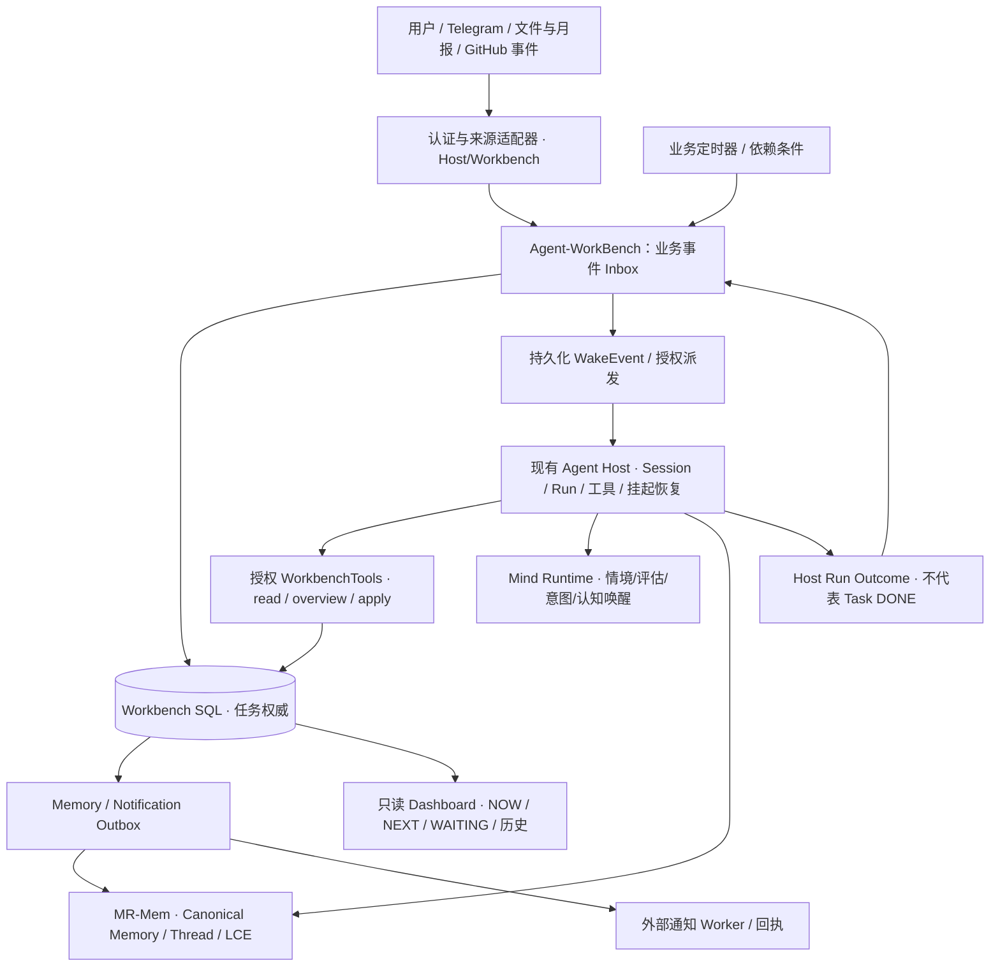

# Agent-WorkBench · 项目总体蓝图与设计推导

> 状态：**开发分支设计基线 / Proposed**，不等于系统已部署。维护对象：独立 `Agent-WorkBench` 仓库。
> 
> 原则：先描述实际问题与权威边界，再定义可验证协议，最后落到模块与代码。本文与 [ADR-0002](ADR-0002-ALWAYS-ON-OWNERSHIP.md)、[Host Run 协议](HOST_RUN_PROTOCOL.md)、[实施计划](IMPLEMENTATION_PLAN.md) 配合阅读。

## 0. 我们为什么做这个项目

目标不是发明另一款任务列表，也不是把整个 Agent Runtime 改造成日程管理器。实际需求是在多 Agent、多入口和长时间中断条件下，**让现实工作的状态连续存在**：

- 用户通过既有 Agent、Telegram、项目仓库和每月报表自然地产生工作事实，不需要每天手工维护看板；
- 既要能追问“本来计划做什么、做到了哪里、还差什么”，也要回答“为什么延期、在等谁、何时催、对方是否回复”；
- Agent A 更新后 Agent B 立即看到相同的任务版本，同时能选择性利用 MR-Mem 提供的历史决策语境；
- 即使没有持续运行的模型、Host 重启、MR-Mem 编译延迟，承诺、任务、审批和提醒仍可靠存在；
- 高老师通过 Telegram 提需求只是**一个受控入口**，不是把全部产品塑造成外部需求收件箱。

设计推导：静态任务列表不足以解释演变；纯语义记忆不能保证事务、期限与权限；持续运行 LLM 容易浪费资源且无法取代可靠状态机。因此采用**SQL 业务事件权威 + 事件唤醒 + 现有 Agent Host 执行 + 可选认知/记忆上下文**。

## 1. 整体架构



四种状态必须分开保存，而不是用一个“当前状态”字段混合：

| 状态 | 真正的权威 | 为什么 |
|---|---|---|
| 当前任务及承诺 | WorkBench SQL | 需要事务、ACL、截止日、版本控制、审计 |
| 一次模型/工具执行的 Run、Session、checkpoint | Agent Host | Host 才知道工具是否真正开始、是否可恢复、是否有副作用 |
| MR 当前认知/情感/关系、WakeSignal、DecisionContext | Mind Runtime | 属于 Soul 的内在状态与意图，不是外部任务派发命令 |
| 语义记忆、支持证据、Thread/LCE | MR-Mem | 用于跨会话理解；编译可能滞后，不覆盖 SQL 任务当前态 |

**没有第四个新 Agent OS。** WorkBench 不是 Host；MR 不是工具调度器；MR-Mem 不是会话库或任务库。

## 2. 模块化分层与仓库目录

以下目录分“已有”和“计划”，不以概念目录冒充已交付模块。

```text
Agent-WorkBench/
├─ db/
│  └─ schema.sql                     [已有] 首次建库 Schema；未实现版本化 migration
├─ src/workdesk/
│  ├─ contracts.py                   [已有] 固定受信 ActorContext + Agent 工具门面
│  ├─ user_context.py                [已有] SQL 授权检查
│  ├─ runtime_bridge.py              [已有] WakeEvent ledger / Host Protocol
│  ├─ identity/                      [规划] 受信账号解析、成员/角色与任务级 ACL
│  ├─ domain/                        [规划] Project, Task, TaskEvent, Dependency, Commitment
│  ├─ application/                   [规划] TaskService、幂等命令、版本冲突、事务
│  ├─ intake/                        [规划] Telegram、月度文件、外部事件正规化
│  ├─ scheduling/                    [规划] Timers、条件触发、lease/reconcile
│  ├─ approvals/                     [规划] 审批作用域、审计、失效与回调
│  ├─ host_adapters/                 [规划] 已有 Agent Host 的 RunPort
│  ├─ memory_bridge/                 [规划] MR-Mem SourceRef 与 Outbox 投影
│  └─ query/                         [规划] 业务查询、历史和增量投影
├─ dashboard/                         [规划] 独立只读界面
├─ migrations/                        [规划] 正式版本化 SQL 迁移
├─ tests/                             [已有] Schema、授权、WakeEvent、工作空间约束
└─ docs/                              [已有] 设计、契约、审计、实施与验收
```

模块依赖方向：`domain <- application <- adapters`。接口属于领域/应用层，不允许将 Telegram 的 update 格式、MR-Mem 的内部表或 Hermes 的 Session 类型直接穿透到业务领域层。业务服务对 Agent 暴露少量粗粒度工具，而不是“一字段一个工具”。

## 3. 业务领域：为何采用当前快照 + 不可变事件

`tasks` 保存**现在是什么**；`task_events` 保存**为什么变成这样**。例如：

```text
09:00 用户计划编写报价方案（create, READY）
12:00 初稿完成并发出（deliverable_submitted, WAITING）
次日 外部承诺周五答复（commitment_recorded）
周五 到期仍未回复（reminder_due → wake_event）
周五 已收到明确意见（feedback_received → dependency_resolved）
周五 任务恢复 READY；旧提醒取消
```

业务字段需要独立含义：

- `official_due_at`：外部/正式期限，不能由模型推断偷偷修改；保留原始当地日期及 IANA 时区；
- `soft_due_at`：内部计划节点；`planned_start_at`：预定启动；`next_review_at` 或提醒记录：何时复核；
- `state`：INBOX、READY、DOING、WAITING、BLOCKED、DONE、CANCELLED；它不是 NOW/NEXT 排序；
- `task_focus`：NOW/NEXT 是呈现和人工选择，不是第二套任务状态；
- `dependencies`：等待的内容、责任对象、解除来源；`reminders`：在什么条件下提醒；
- `task_events`：来源、明确/第三方转述/模型推断、操作者、旧新值、发生与记录时间；
- `commitments`、`deliverables`、`decision_inbox`、`work_resumption`：**候选后续实体**。先在 ADR/领域契约中确认持久状态与引用，再决定迁移，不提前假称已建表。

采用事件日志的理由不是追求“事件溯源”标签，而是：只有保留历史变更的来源和理由，才能可靠回答“怎么延期了两次”“什么事情我答应过他”“哪一次交付才是真正验收”。当前快照和事件写入必须原子提交，事件不能被普通任务更新 API 原地覆盖。

## 4. 两条互相独立的状态机

### 业务任务状态

```text
INBOX → READY → DOING → WAITING / BLOCKED → READY / DOING → DONE
                      └──────────────────────────────────────→ CANCELLED
DONE → READY（只有显式 reopen 事件）
```

状态转移由业务服务验证。Agent 只提交意图与依据；“消息发送成功”不能证明项目 DONE；“别人说已经做完”记录为第三方主张，不能未经核验升级为实际完成。延期需记录理由与来源，不能仅替换一个时间值。

### 工作事件 / Host Run 状态

```text
source accepted → wake.pending → wake.leased → completed / deferred / failed
                                    └ timeout → unknown → reconcile
```

`WakeEventStore` 已实现基础的去重、claim、settle、unknown。它**没有实现**真实的 Host 派发、Run 续跑或审批执行。Host 自己保存 Run、Session 和挂起工具调用；WorkBench 只持有无授权能力的关联引用。两条状态机不能通过字符串相等来同步。

## 5. 三条核心时序

### A. 日常更新 → 多 Agent 同步

1. 受信入口验证操作者、群/账号、目标工作空间；记录原始来源引用。
2. 现有 Agent Host 解释用户说法；通过 WorkbenchTools 读取当前 SQL 任务和 version。
3. Agent 提交 `apply(operations, idempotency_key, expected_version)`。
4. WorkBench 服务校验 task ACL、状态机与证据，单 SQL 事务提交快照+事件+命令回执+必要 outbox。
5. 其它 Agent 下一次直接读 SQL 立即看到 v+1；MR-Mem 通过可重试 Outbox 后续获得合适的语义投影。
6. 如果记忆落后，回答任务状态时以 SQL 为准；不能把衍生的旧记忆当作新任务事实。

### B. 计时器 → 主动唤醒

1. 业务调度器检查 due 和等待解除条件；
2. 领取对应 timer 后**同事务**插入 source-derived 唯一 WakeEvent，并更新 timer 触发状态；
3. 派发器投递事件 ID 与 SourceRef 给现有 Host，Host 幂等决定是否启动 Run；
4. Host 返回 Run Outcome；业务服务记录结果、通知意图及引用，最终是否 DONE 另由任务事务决定；
5. Host 超时且无法确认是否执行时写为 `unknown`，先查询 Host/回执再决定下一步，不自动重发具有外部副作用的请求。

### C. 工具调用等待人工批准

1. Host 判断工具调用需要授权，保存自己的 Session/checkpoint/deferred call；
2. WorkBench 记录待决策对象：限定批准人、限定动作和范围、过期时间、来源与待回复事项；
3. 发送消息经外部 delivery outbox，失败或未知不会被标为已读；
4. 授权人通过受信入口回复，系统生成新 `approval_decided` 事件；
5. Host 检查此决定是否覆盖**当前工具、参数、收件人、权限、会话版本和有效期**，然后续跑或拒绝；
6. WorkBench 对应任务可以仍然 WAITING 或 DOING；审批结果本身不自动等于任务完成。

## 6. 身份、隐私、来源与外部副作用

- 以平台已验证的身份/连接 ID 解析 principal；不能让 LLM 自己声称是 owner。
- 工具端受信 `ActorContext` 不等于 URL 参数或消息里的名字。每次敏感查询重查 Workspace/Task 作用域与撤权状态。
- 分享一个 Agent 或同一模型，不等于分享记忆的 USER scope；MR-Mem 读取须按当前 SourceRef/ACL 双重校验。
- 原始 Telegram 会话的权威仍留在实际 Host/原生来源层；WorkBench 保存 message ID、raw_source_ref、业务摘要和相关 task 引用。
- 原文缺失、删除、撤回、授权撤销后不得从旧语义缓存重新吐出敏感内容。
- Telegram sendMessage 没有通用幂等保证；模糊发送结果标记 `unknown`，核对 provider receipt 后再处理。
- MR 内部 WakeSignal/投影是认知事实，不是现实授权；不能凭 MR 动机调用具外部副作用的工具。

## 7. 容错与取舍

| 决策 | 选择 | 原因与代价 |
|---|---|---|
| 数据库 | SQLite + WAL + 单写服务起步 | 本地 NAS 稳定低成本；跨机多写才考虑 PostgreSQL；避免 NFS/SMB 并行写 |
| 当前态 | SQL snapshot + append-only events | 快速读 + 可追溯演变；必须维护严格原子性 |
| 异步副作用 | Transactional Outbox + receipts | SQL 事务无法涵盖 Telegram/Host/MR-Mem；接受 eventually-consistent 结果，不伪称“分布式原子提交” |
| Agent 宿主 | 复用已有 Agent Host | 防止重复 Agent Loop/Session；真实 Host 的幂等与恢复能力须先盘点 |
| 用户记忆 | MR-Mem Sidecar | 多 Agent 共享语义上下文，不把业务状态移交给向量检索 |
| 认知引擎 | MR 可选消费/提供认知上下文 | 不让 Soul 代替 Body 的权限与执行 |
| 页面 | 只读投影 | 避免另一个竞争的写入权威；之后若需编辑，必须调用同一业务 API |

故障矩阵：SQL 不可用→业务写入明确失败；MR-Mem 不可用→任务不回滚、outbox 等恢复；Host 进程死→SQL 保留事件、Host 负责 Run 恢复；计时器停机→重启补扫；审批撤销→恢复时拒绝；外部通知结果不明→标 unknown 并核查，不能盲目重发。

## 8. 施工依赖与客观完成条件

| 阶段 | 交付 | 完成证据 |
|---|---|---|
| P0 领域与授权 | 真实 TaskService、幂等更新、版本冲突、任务可见性、事件原子写 | Agent 工具端到端 SQLite 测试，重启/并发/越权负测 |
| P1 业务事件与定时器 | timer→WakeEvent、Host dispatch/reconcile、delivery outbox | 断点注入、重复事件、unknown 与复核演练 |
| P2 Host 对接 | 受信 Bot/Agent 身份与事件传递、Host Run 幂等及 Deferred Resume | 真实 Host checkpoint 恢复、拒绝越权审批 |
| P3 记忆对接 | 语义筛选、SourceRef 实时校验、撤权与失效处理 | MR-Mem 延迟/故障/跨 Agent 一致性测试 |
| P4 日常界面与导入 | 只读 Dashboard、月报导入及增量回溯 | 来源增量核对、权限过滤、移动端展示 |
| P5 运行部署 | NAS Docker、Tailscale、迁移、备份恢复、告警 | 生产前端到端演练及回滚演练 |

**现在远端已提交的**：Bootstrap SQL、用户记忆授权检查、Agent 工具协议、WakeEventStore/Host Protocol、若干复合 FK、安全与离线合同测试、架构/实施文档。**尚未提交的**：正式 SQL TaskService、可用的 Host dispatch/审批服务、Telegram 真实入口、MR-Mem 生产桥、Scheduler/通知 Worker、Dashboard、NAS 部署。此前本地参考实现的测试不是远端这些模块已经交付的证明。

## 9. 反例及冻结边界

- “模型已经记住任务”不是 SQL 事务完成；“Agent Run completed”不是交付验收。
- “高老师能向 Bot 发消息”不是获得 owner's user memory 权限。
- “MR 发出 WakeSignal”不是直接发送 Telegram 的授权。
- “审批记录为 approved”不是无条件恢复以前挂起的工具调用。
- “CI 通过”不是端到端接入或长期稳定性已验证。
- 正式业务功能不先做需求验证型 MVP；**但工程上线必须通过可靠性和权限验收**。

## 10. 跨仓库设计入口

- 本仓库：[ADR-0002](ADR-0002-ALWAYS-ON-OWNERSHIP.md) / [Host 协议](HOST_RUN_PROTOCOL.md) / [MR-Mem 接线](MRMEM_INTEGRATION.md)
- [MR-Mem · WorkBench 集成设计](https://github.com/Jasonatafricanow/MR-Mem/blob/feat/workbench-user-context-20261116/docs/WORKBENCH_DESIGN_RATIONALE.md)
- [Mind Runtime · Cognitive Wake 与 Host 交接设计](https://github.com/Jasonatafricanow/Mind-Runtime/blob/docs/always-on-workbench-boundary-20261116/docs/integrations/WORKBENCH_DESIGN_RATIONALE.md)

本文件只确定 WorkBench 自己拥有的业务状态和对外契约，MR/MR-Mem 的冻结规则仍以各自仓库正式 ADR 与当前代码为准。
